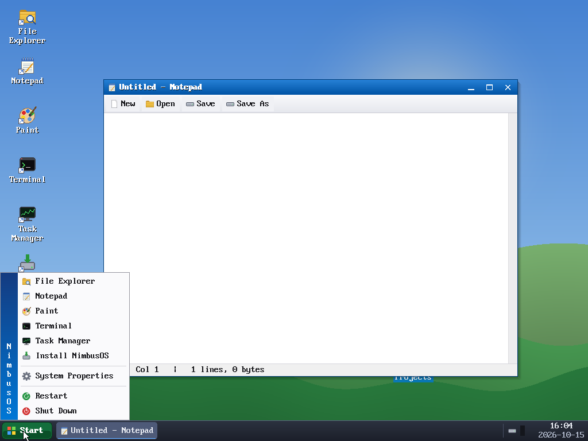
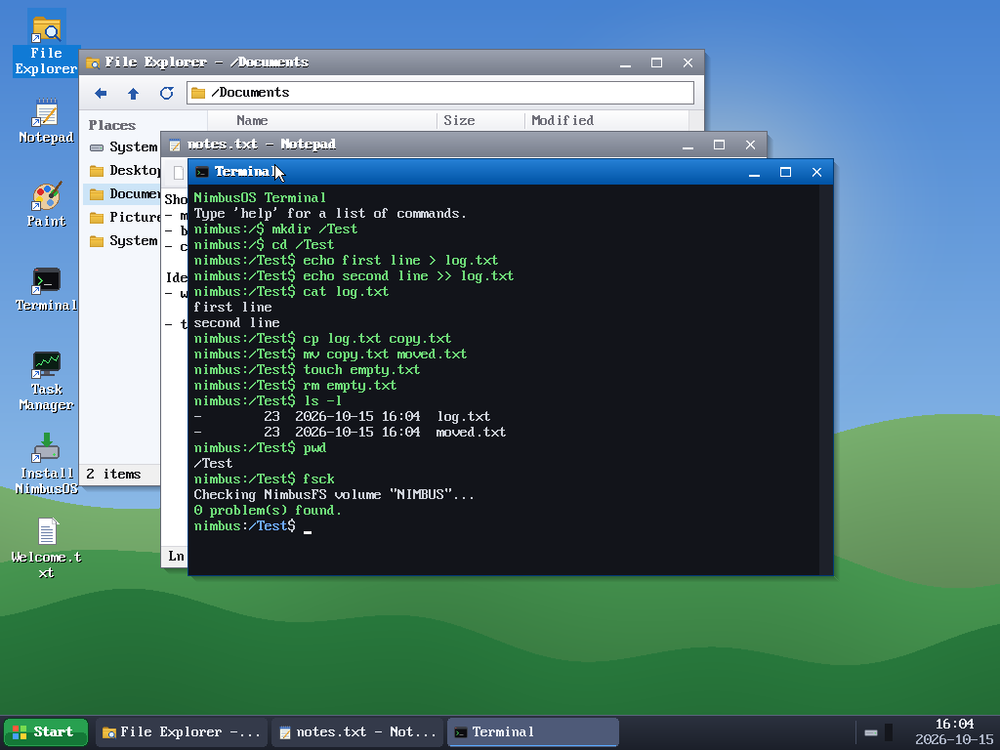
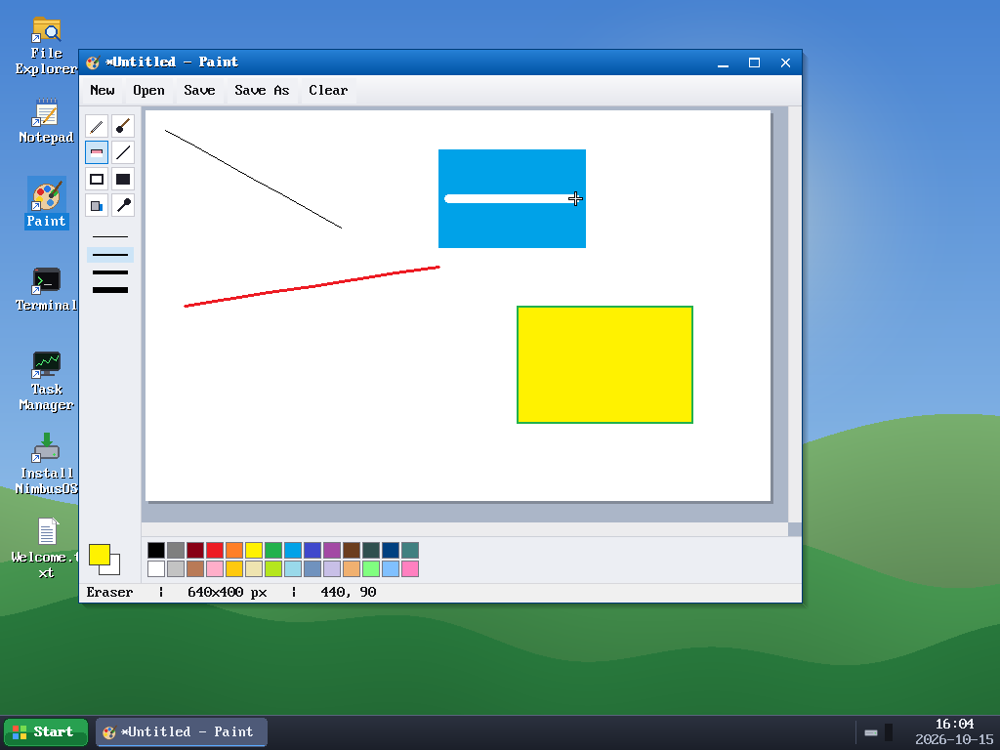
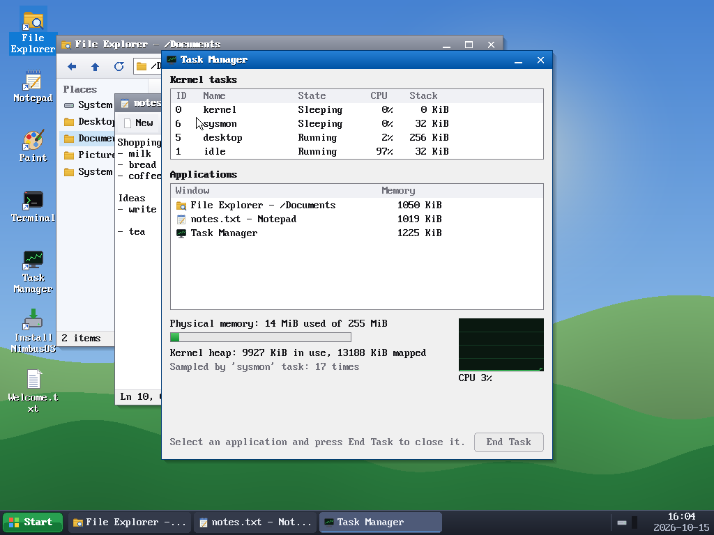
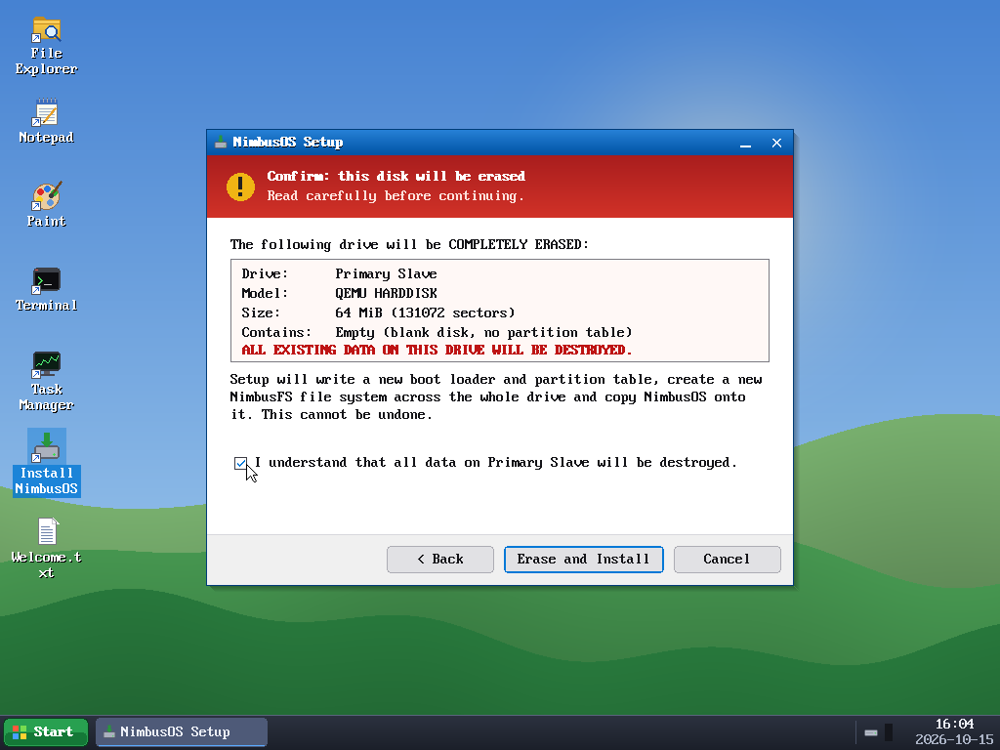
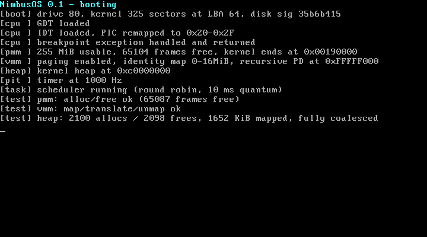
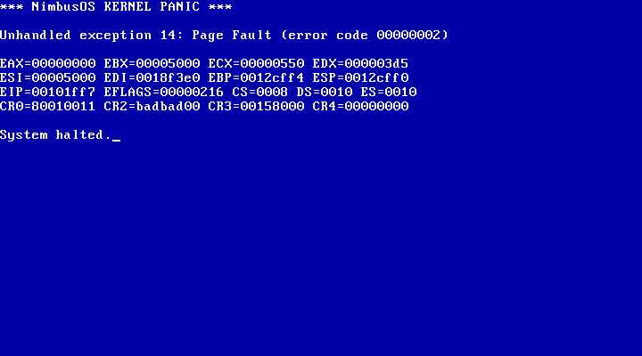
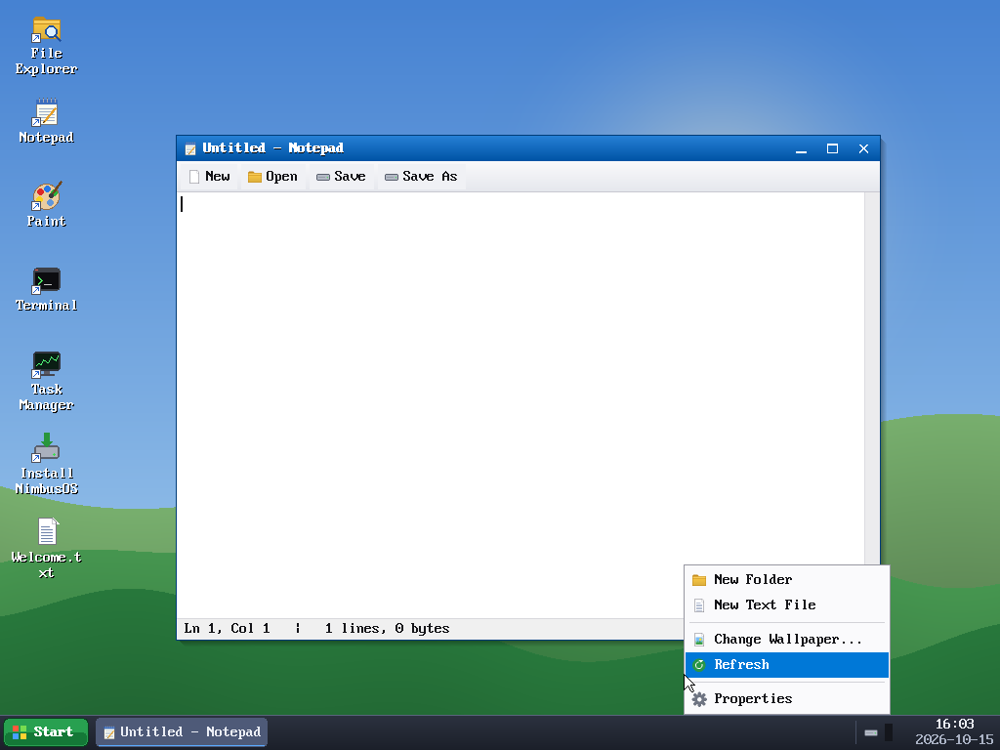
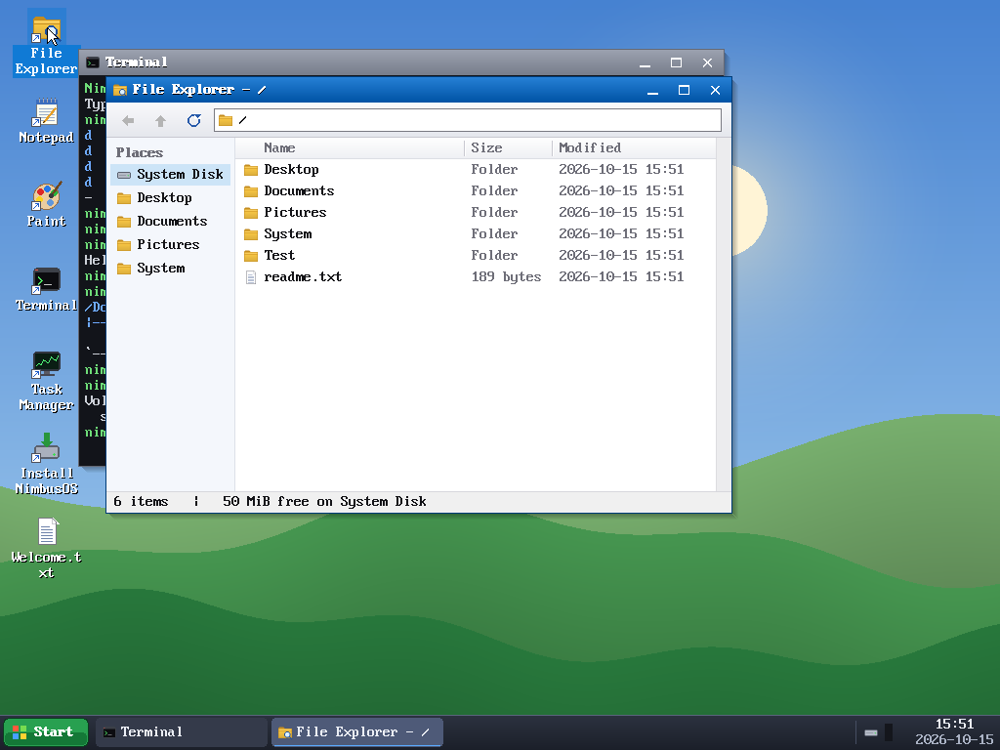
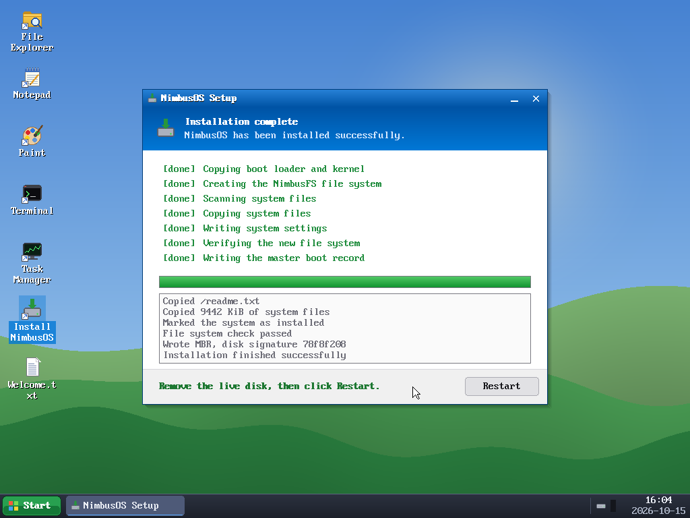

# NimbusOS

A small hobby operating system for 32-bit x86, written from scratch in C with a
little assembly. It boots from its own MBR bootloader into a Windows-style
desktop with draggable, resizable windows, a taskbar and Start menu, a File
Explorer, Notepad, Paint, a Terminal, a Task Manager and a graphical installer.
Everything (bootloader, kernel, drivers, file system, compositor, widgets,
apps) is original code: no existing kernel, libc or GUI library is used.



| | |
|---|---|
|  |  |
|  |  |

---

## Quick start

```sh
make build        # -> build/nimbus.img (64 MiB bootable disk image)
make run          # boot it in QEMU (serial log on the terminal)
make test         # host-side file system test suite
make test-all     # host suite + every QEMU stage test (headless)
```

| Target | What it does |
|---|---|
| `make build` | Assembles the bootloader, compiles the kernel, builds the host tools, creates `build/nimbus.img` and populates its NimbusFS partition from `rootfs/` plus generated wallpapers |
| `make run` | `qemu-system-i386 -m 256M -vga std` on the image, COM1 on stdio |
| `make debug` | Same, but QEMU starts paused with a GDB stub on `:1234` (prints the `gdb` command to use; symbols come from `build/kernel.elf`) |
| `make iso` | Builds the bootable live CD `build/nimbus.iso` |
| `make run-iso` | Boots the ISO in QEMU as a CD-ROM |
| `make clean` | Removes `build/` |
| `make test` | Builds and runs `tools/fstest` (NimbusFS test suite, on a scratch image file) |
| `make fsimage` | Uses the formatter to create an empty standalone file system image `build/empty-fs.img` |
| `make installer-test` | Boots the live image with a **blank** 64 MiB `build/target.img` attached as the second drive |
| `make run-target` | Boots only `build/target.img` (after installing onto it) |
| `make test-all` | Runs everything automated (≈ 2 minutes) |

Add QEMU options with `QEMU_EXTRA`, e.g. `make run QEMU_EXTRA="-display sdl"`.

> **Safety.** The build and every tool only operate on regular `.img`
> files they create and name explicitly. `mkimage` and `nfstool` refuse to
> open block/character devices, and nothing uses `dd`, `fdisk`, `mkfs` or
> `diskutil`. The installer only runs inside QEMU against the attached image
> files, and only after an explicit confirmation (see Stage 7).

## Live CD (`make iso`)

`build/nimbus.iso` is an ISO 9660 image with an El Torito boot entry using
**hard-disk emulation**, written by `tools/mkiso.c` (no external ISO tools
are needed). The BIOS presents the embedded 32 MiB copy of the disk image as
drive 0x80, so the normal MBR and stage 2 boot from it.

* That copy carries a `RAMD` flag, so stage 2 loads the *whole* image into RAM
  at 16 MiB. The kernel then mounts its file system from that RAM disk, which
  is needed because a CD is read-only and there is no ATAPI driver.
* It is a true live system: everything works, but changes are lost at power-off.
* Run the installer from the live CD to put NimbusOS on a hard disk; the
  installed disk boots normally from ATA.
* Both boot loaders fall back to CHS reads (INT 13h AH=02h, geometry from
  AH=08h) when the BIOS has no LBA extensions, which is typical for emulated
  disks.

```sh
make iso && make run-iso
# VirtualBox / VMware: create a 32-bit "Other" VM with a 64+ MiB IDE disk,
# attach nimbus.iso as the CD, use the standard VGA adapter.
```

## Installing the toolchain

You need: a cross compiler for `i686-elf` (GCC **or** Clang + LLD), NASM, a host C
compiler, QEMU, GNU make and Python 3 (Pillow is optional: it converts test
screenshots to PNG and checks Paint's BMP output).

The Makefile auto-detects the compiler: if `i686-elf-gcc` is on `PATH` it uses
`i686-elf-gcc` + `i686-elf-ld`, otherwise `clang --target=i686-elf` + `ld.lld`.
Override with `make TOOLCHAIN=gcc` / `make KCC=... KLD=...`.

**macOS (Homebrew)**
```sh
brew install i686-elf-gcc i686-elf-binutils nasm qemu      # GCC cross toolchain
# or, instead of i686-elf-gcc:  brew install llvm lld       (Clang path)
python3 -m pip install pillow                               # optional
```

**Debian / Ubuntu**
```sh
sudo apt install build-essential nasm qemu-system-x86 clang lld python3-pil
```

**Building i686-elf-gcc from source** (any Unix; see OSDev wiki "GCC Cross-Compiler"):
```sh
export PREFIX="$HOME/opt/cross" TARGET=i686-elf PATH="$HOME/opt/cross/bin:$PATH"
# binutils
../binutils-2.42/configure --target=$TARGET --prefix="$PREFIX" --with-sysroot --disable-nls --disable-werror
make && make install
# gcc (C only, no libc)
../gcc-14.1.0/configure --target=$TARGET --prefix="$PREFIX" --disable-nls --enable-languages=c --without-headers
make all-gcc all-target-libgcc && make install-gcc install-target-libgcc
```
The kernel does not link libgcc: the few 64-bit division helpers the compiler
needs are in `kernel/libgcc.c`.

## Source layout

```
arch/x86/      boot/mbr.asm, boot/stage2.asm, entry.asm, isr.asm, GDT, IDT/PIC, linker script
kernel/        main, printf, string, panic, PMM, paging (VMM), heap, tasks/scheduler, ACPI power, self tests
drivers/       serial, VGA text, PIT, PS/2 controller, keyboard, mouse, PCI, framebuffer (Bochs VBE), ATA PIO, RTC
fs/            nbfs.[ch] NimbusFS (shared with host tools), vfs.[ch] volume glue for the kernel
gui/           gfx (primitives + font), wm (compositor/window manager), desktop, taskbar, menu, widgets,
               dialogs (message/input/file), icons, cursor, BMP codec, clipboard
apps/          explorer, notepad, paint, terminal, taskmgr, sysprops, app registry
installer/     graphical installer
tools/         mkimage, nfstool (formatter + file tool), fstest (FS test suite), mkwallpaper,
               qemu_harness.py + test_stage1..7.py (headless QEMU tests)
rootfs/        files copied into the system volume at build time
```

## Boot sequence

```
BIOS ──► LBA 0: MBR (arch/x86/boot/mbr.asm, 512 bytes, loaded at 0x7C00)
          │  reads its boot-info block (patched by tools/mkimage) and loads
          │  stage 2 with INT 13h AH=42h (LBA extended read)
          ▼
         LBA 1..: stage 2 (arch/x86/boot/stage2.asm, at 0x8000, real mode)
          │  1. enable A20 (BIOS INT 15h/2401 + port 0x92)
          │  2. E820 memory map  -> 0x5100
          │  3. copy the 8x16 VGA ROM font (INT 10h AX=1130h) -> 0x6000
          │  4. load the kernel 32 KiB at a time into a bounce buffer at
          │     0x20000 and copy it to 1 MiB using "unreal mode"
          │  5. load a flat GDT, set CR0.PE, far jump to 32-bit code
          ▼
         0x100000: kernel entry (arch/x86/entry.asm): zero .bss, set up the
          │  boot stack, call kmain(bootinfo*)   (boot info at 0x5000)
          ▼
         kmain (kernel/main.c)
            serial + VGA text log, GDT, IDT + PIC remap        (stage 1)
            PMM, paging, heap, PIT, scheduler, self tests      (stage 2)
            PS/2 kbd + mouse, ATA, PCI                         (stage 3)
            mount NimbusFS from the boot disk, FS self test    (stage 4)
            ACPI, font, framebuffer 1024x768x32, start the
            "desktop" task (window manager + apps) and the
            "sysmon" task                                      (stages 5-7)
```

### Disk layout (`build/nimbus.img`, 64 MiB)

| LBA | Contents |
|---|---|
| 0 | MBR: boot code, boot-info block at 0x1A0 (`NBT1`, stage 2 + kernel location), disk signature at 0x1B8, partition table |
| 1 – 63 | stage 2 |
| 64 – 4095 | kernel flat binary (up to ~2 MiB) |
| 4096 – end | partition 1, type `0x4E`: NimbusFS system volume |

### Memory layout

| Virtual | Use |
|---|---|
| `0x00000000` | unmapped page (NULL-pointer guard) |
| `0x00001000 – 0x00FFFFFF` | identity mapped: BIOS data, boot info + font (0x5000/0x6000), kernel at 1 MiB, page directory, PMM bitmap |
| `0xC0000000 – 0xCFFFFFFF` | kernel heap, grown page by page from the PMM |
| `0xE0000000 – …` | linear framebuffer (physical address from PCI BAR0) |
| `0xFFC00000 – 0xFFFFFFFF` | recursive mapping of the page tables |

ACPI tables and other MMIO are identity mapped on demand.

---

## Stage 1 – Boot

**What's there:** `mbr.asm` (stage 1), `stage2.asm`, `entry.asm`, a flat GDT
(`arch/x86/gdt.c`), 256 IDT gates generated by a NASM macro (`isr.asm`), the
8259 PIC remapped to vectors 0x20–0x2F, a VGA text console and a COM1 serial
logger (115200 8N1). Every kernel log line goes to the serial port.

**Run:** `make run` and look at the first second of output, or `python3 tools/test_stage1.py`.

**Expect:** `NimbusOS MBR`, `NimbusOS stage2`, `Loading kernel....... ok` from
the BIOS, then the kernel's log: GDT/IDT loaded, an `int3` breakpoint exception
that is handled and returns.



## Stage 2 – Core kernel

* **Physical memory:** bitmap allocator, one bit per 4 KiB frame over 4 GiB,
  initialised from the E820 map (`kernel/pmm.c`).
* **Paging:** two-level 32-bit paging with a recursive page directory
  (`kernel/vmm.c`), NULL guard page, heap and framebuffer regions as above.
* **Heap:** `kmalloc/kzalloc/krealloc/kfree` with 16-byte headers, next-fit
  allocation, splitting, coalescing of both neighbours, magic numbers to catch
  corruption, `heap_check()` walker (`kernel/heap.c`).
* **Timer + scheduler:** PIT at 1 kHz; preemptive round-robin kernel threads
  with a 10 ms quantum. The context switch is done by the IRQ stub, which
  returns a different task's saved register frame; `task_yield`/`task_sleep`
  use a software interrupt. Per-task CPU accounting feeds Task Manager.
* **Panic:** exceptions and `panic()` dump EAX–EDI, EIP, EFLAGS, segment and
  control registers (CR2 for page faults) to serial and to the screen (VGA
  text early, a blue framebuffer screen once graphics are on).

**Test:** `python3 tools/test_stage2.py` runs the boot self tests (PMM, VMM,
2000 random heap operations with content checks, three tasks, one of which never
yields and so needs preemption). It then builds a second kernel with
`-DPANIC_TEST`, which writes to an unmapped address, and checks the register dump.



## Stage 3 – Drivers

* **PS/2 keyboard:** scancode set 1 (controller translation on), `0xE0`
  extended keys, Shift/Ctrl/Alt/Win/Caps Lock, a 128-entry key event queue.
* **PS/2 mouse:** 3-byte packets with bit-3 resynchronisation, overflow
  rejection, absolute position clamped to the screen, button state. Motion is
  coalesced in the queue, but button changes are never merged, so clicks keep
  their exact position.
* **Graphics:** Bochs/QEMU "DISPI" VBE extension (ports 0x1CE/0x1CF), LFB
  address from PCI BAR0, 1024×768×32. `gui/gfx.c` has pixel, Bresenham line,
  thick line, rect, filled rect, alpha-blended rect, gradient, midpoint
  circle/filled circle, rounded rect, opaque/ARGB/scaled blits and 8×16 text.
  All of it is clipped to a per-surface clip rectangle. The font is the VGA
  BIOS ROM font, copied by stage 2.
* **ATA PIO:** IDENTIFY on all four IDE positions, LBA28 READ/WRITE SECTORS
  with polling, FLUSH CACHE after writes.
* **Also:** PCI config mechanism #1, CMOS RTC with BCD/12h handling.

**Test:** `python3 tools/test_stage3.py` attaches a second blank disk and
checks that both drives are identified and the framebuffer mode is set. It then
types `echo Hello, World! (Caps & Symbols: ~!@#$%^&*_+{}|:<>?)` into the
Terminal and checks it arrives exactly, and double-clicks an icon at exact
coordinates. (Before Stage 5 replaced it, this stage had a dedicated
driver-demo screen; see the git history, commit "Stage 3".)

## Stage 4 – File system: NimbusFS

**Design decision: custom FS vs FAT.**
* FAT16/32 could be mounted on the host directly. But long names need the
  VFAT LFN extension, timestamps are coarse, and cluster chains make random
  writes and metadata awkward.
* A small ext2-style design is less code for more features. I chose
  **NimbusFS**; the cost is that you inspect images with our own `nfstool`.

**On-disk format** (`fs/nbfs.h`), 1 KiB blocks:
* Layout: block 0 is reserved, block 1 is the superblock, followed by the
  block bitmap, the inode bitmap, the inode table and the data blocks.
* Inodes are 128 bytes: type, links, size, `ctime`, `mtime`, parent inode,
  24 direct pointers, 1 indirect and 1 double-indirect pointer (≈64 MiB per file).
* Directories are files of 64-byte entries (inode, type, name length, 57-char
  name). Inode 1 is the root.

**Operations:** format, mount, lookup, stat, create, mkdir, read, write
(sparse-safe), truncate (zero-fills the tail), unlink, recursive delete,
rename/move (refuses to move a directory into itself), readdir, get-path, and
`nbfs_check` (a full consistency checker). A 64-entry write-through block cache
sits in front of the device.

`fs/nbfs.c` is compiled **unchanged** into the kernel and into the host tools:

* `nfstool mkfs <new.img> <MiB>` is the formatter: it creates a fresh, empty
  file system image (`make fsimage`).
* `nfstool format|ls|tree|cat|put|get|mkdir|rm|mv|import|check|df|blank`
  works on plain FS images or on the NimbusFS partition inside a disk image.
* `make test` runs `tools/fstest` (6,700+ checks). It covers direct, indirect
  and double-indirect files, chunked unaligned writes, truncate + regrow,
  nested directories, 100-entry directories with slot reuse, rename/move, name
  limits, timestamps, disk-full, persistence across remount, and a 3,000-step
  randomized run against an in-memory model. `fsck` runs after every test.
  (The suite found a real block leak in directory shrinking during development.)

**Kernel side:** `fs/vfs.c` finds the boot disk by matching its MBR disk
signature with the one the BIOS booted from, then mounts partition type `0x4E`.
At boot, a self test creates, writes, reads, renames and deletes on the real
ATA disk, then runs the checker (`python3 tools/test_stage4.py`).

## Stage 5 – Desktop environment

**Window manager / compositor** (`gui/wm.c`):
* **Rendering:** each window owns a client surface. Damaged screen rectangles
  are collected (and merged), and only those are recomposed into a back
  buffer: wallpaper → icons → windows bottom-to-top (drop shadow, 1 px border,
  gradient title bar with icon, title and min/max/close buttons, client
  pixels) → dragged icon → taskbar → popup menus. Then only those rectangles
  are copied to the framebuffer, so there is no flicker.
* **Cursor:** drawn last, directly on the framebuffer, with the pixels under it
  saved and restored. There are resize/text/crosshair shapes.
* **Window operations:** move (title bar), resize (all edges and corners,
  ±4 px grab zone), minimize, maximize/restore (button or title double-click),
  close, z-order, focus. Keyboard focus follows the active window. Alt+Tab
  cycles windows, Alt+F4 closes. Modal dialogs block their owner.
* **Event routing:** popup menu → taskbar → windows top-to-bottom (with mouse
  capture while a button is held) → desktop.

**Desktop** (`gui/desktop.c`):
* **Wallpaper** comes from `/System/desktop.cfg` (default
  `/System/wallpaper.bmp`), falling back to a solid colour.
* **Icons** in a grid: one per app plus one per entry of `/Desktop`.
  Single-click selects, double-click opens, and drag snaps to the grid. Icon
  positions are saved in `/System/icons.cfg`.
* **Right-click menu:** New Folder, New Text File (created, then renamed
  inline), Change Wallpaper (live chooser with preview), Refresh, Properties.
  Icons have their own Open/Rename/Delete/Properties menu.
* The desktop notices changes made by other apps.

**Taskbar** (`gui/taskbar.c`):
* Start button, one button per window (click to focus, minimize or restore;
  right-click for a window menu), and a tray with a memory meter.
* The clock reads the RTC at boot and every minute, and advances with the PIT
  in between.
* The Start menu (button, Win key or Ctrl+Esc) lists the apps, System
  Properties, Restart and Shut Down.
* **Shut Down** uses ACPI S5: RSDP → RSDT → FADT → `\_S5` in the DSDT, then
  `SLP_TYP|SLP_EN` to `PM1a_CNT`. **Restart** uses the 8042 reset line, with a
  triple-fault fallback.

**Run:** `make run`.
**Expect:** the desktop above; double-click icons, drag windows, right-click
the desktop.
**Test plan** (`python3 tools/test_stage5.py`):
* Icons appear.
* Double-click opens a window.
* Title-bar drag and corner resize land at exact coordinates.
* Minimize, then the taskbar button restores the window.
* Right-click shows the menu; New Folder + rename creates `/Desktop/Projects`.
* The Start menu opens; icon drag position is persisted.
* Alt+Tab switches windows.
* Shut Down powers QEMU off; Restart reboots it.



## Stage 6 – Applications

| App | Features |
|---|---|
| **File Explorer** | Back / Up / Refresh, address bar, Places sidebar, details list (icon, name, size, modified), double-click opens folders or files (`.txt` → Notepad, `.bmp` → Paint), right-click: Open / Rename / Delete / Properties or New Folder / New Text File / Refresh / Open Terminal Here; keyboard: arrows, Enter, Backspace, Delete, F2, F5; auto-refresh |
| **Notepad** | multi-line editing, caret, mouse and Shift-selection, double-click word selection, insert/delete, Tab, scrolling (scrollbar, PgUp/PgDn, horizontal follow), Ctrl+A/C/X/V (system clipboard), New / Open / Save / Save As (file dialog), "save changes?" prompts on New/Open/Close |
| **Paint** | pencil, brush, eraser, line, rectangle, filled rectangle, flood fill, colour picker; 28-colour palette (left = primary, right = secondary), 4 brush sizes, Clear, live shape preview, scrollable canvas, open/save 24-bit BMP |
| **Terminal** | `ls [-l]`, `cd`, `pwd`, `cat`, `echo`, `mkdir`, `rm [-r]`, `touch`, `mv`, `cp`, `tree`, `stat`, `open`, `df`, `mem`, `ps`, `date`, `uptime`, `fsck`, `history`, `uname`, `clear`, `exit`, `shutdown`, `reboot`, app launchers; `>` / `>>` redirection of any command; history (↑/↓), scrollback (PgUp/PgDn) |
| **Task Manager** | kernel tasks (state, CPU %, stack), application windows with memory use, End Task, physical memory / heap stats, CPU history graph |

**Test:** `python3 tools/test_stage6.py`.
* Explorer: navigation, back/up, create + rename + delete through the context
  menu, opening a file.
* Notepad: edit + Ctrl+S, then `nfstool cat` confirms the content.
* Terminal: a dozen commands including redirection; results are verified on
  the image.
* Task Manager: End Task.
* Paint: draw with six tools, save via the file dialog, reopen it, and check
  pixel colours of the BMP on the host with Pillow.



## Stage 7 – Installer

`installer/installer.c` is a wizard on the live system: **Welcome → Choose
disk → Confirm → Install → Done/Restart.**

* **Choose disk** lists every attached ATA drive with model and size. The live
  boot disk (found by MBR signature) and disks under 16 MiB are shown but
  cannot be selected. Nothing is pre-selected.
* **Confirm** is a red warning page. It shows the drive name, model, size in
  MiB and sectors, and what is on it now (blank / NimbusOS / other partitions).
  It states that *all existing data on this drive will be destroyed*. The
  **Erase and Install** button stays disabled until you tick *"I understand
  that all data on … will be destroyed"*. No byte is written before this
  point, and the target is re-checked right before the first write.
* **Install**, driven by a timer so the UI stays responsive:
  1. Copy stage 2 + kernel (LBA 1–4095).
  2. Create a NimbusFS partition covering the rest of the disk.
  3. Copy every file and folder of the live volume.
  4. Write `/System/installed.txt` (this hides the installer icon on the
     installed system).
  5. Run the consistency checker.
  6. Write the MBR **last**, with a fresh disk signature, so an interrupted
     install never leaves a bootable half-written disk.
* **Done:** Restart.

**Run it yourself:**
```sh
make installer-test       # live image + blank build/target.img (Primary Slave)
# in QEMU: double-click "Install NimbusOS", pick "Primary Slave", tick the box, Erase and Install
make run-target           # boot the freshly installed disk on its own
```
**Automated test** (`python3 tools/test_stage7.py`):
* Proves the live disk can't be picked, and that "Erase and Install" does
  nothing while unticked: the target is still all zeros at that point.
* Installs, restarts, and checks the live image's boot area is byte-identical.
* Checks the target's MBR, runs `nfstool check`, and compares the file tree.
* Boots the target alone to the desktop: it mounts from Primary Master and the
  installer icon is gone.



---

## Design notes and trade-offs

* **Bootloader:** a custom MBR + stage 2 rather than GRUB/multiboot, because
  the task asks for one. Unreal mode keeps stage 2 small while allowing a
  kernel larger than conventional memory.
* **Graphics:** Bochs VBE (DISPI) instead of BIOS VBE calls. It needs no
  real-mode switch at runtime and the mode can be set from C. The trade-off is
  that it only works on Bochs/QEMU/VirtualBox-style adapters (`-vga std`).
* **Identity-mapped kernel** instead of a higher-half kernel: simpler to boot.
  The VMM still provides a real virtual map: NULL guard, heap and framebuffer
  windows, recursive page tables.
* **Kernel threads only (ring 0):** apps are event handlers inside the
  "desktop" task, much like a classic single-threaded GUI toolkit. That keeps
  the window manager lock-free. Preemption is real (the scheduler and the
  `sysmon` task demonstrate it), but there is no user mode or ELF loader.
* **Font:** taken from the VGA ROM at boot rather than embedded, so no
  third-party font data is in the repository.
* **Damage-based compositing:** apps that update a lot (Paint, Terminal)
  invalidate only the rectangles they change. This matters under QEMU's
  software emulation.

## Known limitations

* No user mode, processes, or ELF loading; no networking, sound or USB.
* LBA28 ATA PIO only (disks up to 128 GiB); no AHCI.
* Single CPU; the file system is used only from the GUI task.
* Fixed 1024×768 resolution; needs a Bochs-VBE-compatible adapter.

## References

* Intel® 64 and IA-32 Architectures Software Developer's Manual, Vol. 3A
  (protected mode, descriptors, interrupts, paging).
* OSDev wiki: *Rolling Your Own Bootloader*, *Unreal Mode*, *A20 Line*,
  *Detecting Memory (x86)*, *GDT*, *IDT*, *8259 PIC*, *PIT*, *PS/2 Keyboard*,
  *PS/2 Mouse*, *8042 PS/2 Controller*, *ATA PIO Mode*, *PCI*, *Bochs VBE
  Extensions*, *CMOS*, *Serial Ports*, *Shutdown*, *Reboot*, *Page Frame
  Allocation*, *GCC Cross-Compiler*.
* ACPI Specification 6.4: RSDP, FADT, `\_Sx` objects, PM1 control register.
* T13 ATA/ATAPI-6: IDENTIFY DEVICE, READ/WRITE SECTORS, FLUSH CACHE.
* Microsoft BMP file format (BITMAPINFOHEADER).
